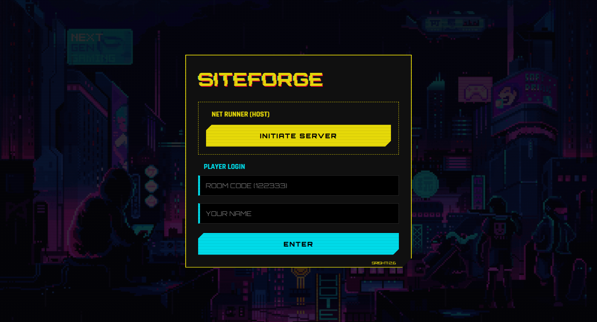
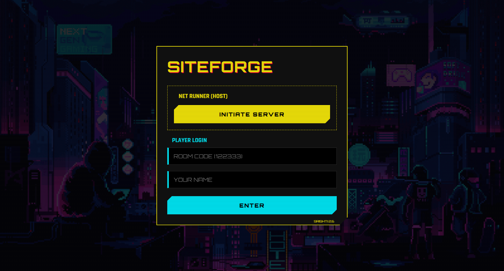

# Full_Stack_Quiz_Game_Web_Application

<p align="center">
  
  
  
  
  
  
</p>

A real-time, interactive full-stack multiplayer quiz game web application. Host live trivia rooms, join instantly via unique room codes, answer timed questions concurrently, track live leaderboards, and celebrate winners on the animated podium.

---

## 📸 Hero Preview

<p align="center">
  
</p>

## 🖼️ UI Snapshot Gallery

<p align="center">
  
  
</p>

---

## ✨ Features

- 🎮 **Real-Time Multiplayer Engine** - Seamless WebSocket synchrony via Socket.io for instant lobby joins, buzzer clicks, and round transitions.
- ⏱️ **Dynamic Time & Speed Scoring** - Timed question countdowns where faster correct answers yield higher points.
- 🏆 **Round Leaderboards & Winner Podium** - Continuous score updates between questions leading to a celebratory 1st, 2nd, and 3rd place podium.
- 🕹️ **Arcade Neon UI** - Responsive dark cyberpunk design system optimized for mobile players and projector/large-screen hosts.
- 👥 **Host vs Player Perspectives** - Dedicated host controller dashboard alongside streamlined mobile player buzzers.

---

## 🛠️ Tech Stack

- **Client**: React 19, Vite, Socket.io-Client, Modern CSS3
- **Server**: Node.js, Express, Socket.io (WebSocket Event Engine)

---

## 🚀 Quick Start

### 1. Clone the repository
```bash
git clone https://github.com/soorajstudio/Full_Stack_Quiz_Game_Web_Application.git
cd Full_Stack_Quiz_Game_Web_Application
```

### 2. Start Backend Server
```bash
cd server
npm install
npm start
```

### 3. Start Frontend Client
```bash
cd ../client
npm install
npm run dev
```

Open [http://localhost:5173](http://localhost:5173) in your browser.

---

## 📄 License

This project is licensed under the MIT License — see the [LICENSE](LICENSE) file for details.

Developed with ❤️ by [Sooraj Studio](https://github.com/soorajstudio).
